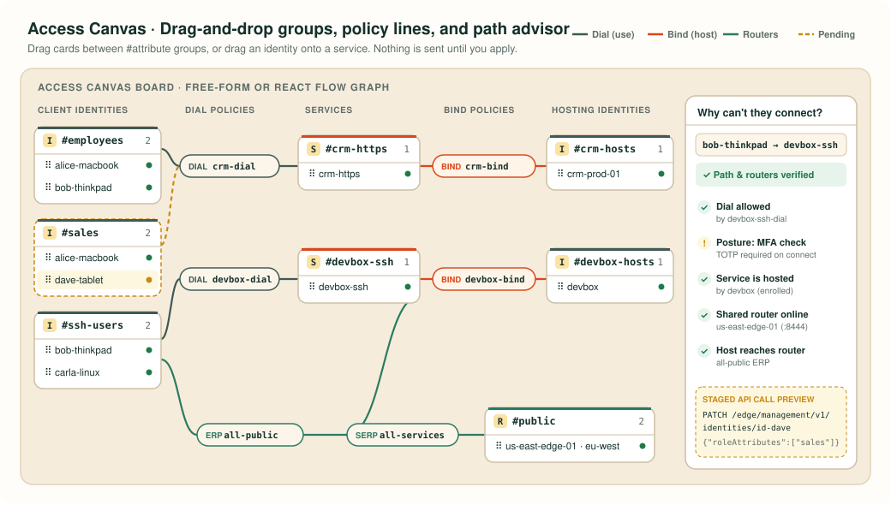
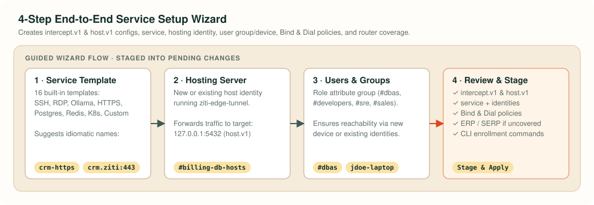
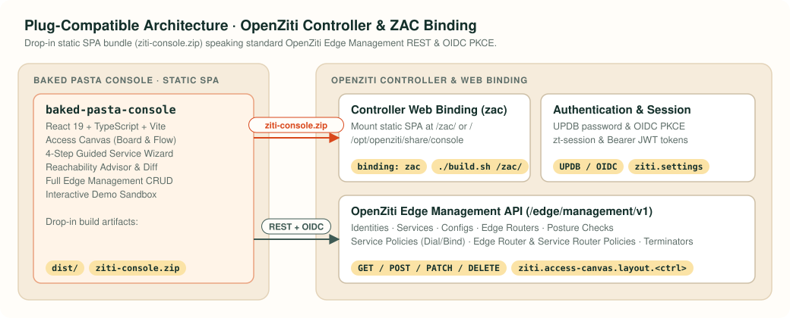

<picture>
  <source media="(prefers-color-scheme: dark)" srcset="assets/logo/baked-pasta-console-lockup-on-dark.svg">
  
</picture>

# Baked Pasta Console

Everything ziti needs, layered, baked, and visualized: a modern, sleek, plug-compatible [OpenZiti Admin Console (ZAC)](https://github.com/openziti/ziti-console) featuring the interactive **Access Canvas** and **4-step Guided Service Wizards**.

> [!NOTE]
> This is an independent community project, not affiliated with NetFoundry or the [OpenZiti](https://openziti.io) project.

---

## ✨ Why Baked Pasta Console?

Managing a Zero-Trust Network Overlay typically means juggling half a dozen interrelated tables: **Identities**, **Configs** (`intercept.v1`, `host.v1`), **Services**, **Service Policies** (`Dial` and `Bind`), **Edge Router Policies**, and **Service Edge Router Policies**. One missing attribute or router policy silently breaks connectivity.

**Baked Pasta Console** brings the **Access Canvas** and guided wizards to a modern **React 19 + TypeScript + Vite + Tailwind CSS + React Flow** stack as a drop-in replacement for the upstream console: the controller's `zac` web binding serves it from the same `ziti-console.zip` layout, and it talks to the same management API.

| Capability | Upstream `openziti/ziti-console` | `baked-pasta-console` |
| :--- | :--- | :--- |
| **Deployment Artifacts** | Static SPA (`ziti-console.zip` at `/zac/` or `/`) | **Same packaging** (`ziti-console.zip` & `./build.sh <base-href>`) |
| **Controller Auth & Storage** | `/edge/management/v1/authenticate`, `/oidc` PKCE, `localStorage['ziti.settings']` | **Same endpoints & `ziti.settings` session key** (`zt-session` or `Bearer` JWT) |
| **Visual Policy Authoring** | Table/form-centric administration | **Interactive Access Canvas** (Free-Form Drag-and-Drop Board + React Flow Graph) |
| **Service Provisioning** | Multi-page manual config + service + policy creation | **4-Step End-to-End Service Setup Wizard** (16 templates, auto-named configs & policies) |
| **Change Safety** | Immediate writes on form save | **Staged Pending Changes Drawer** with REST API payload diff & one-click **Session Undo** |
| **Connectivity Debugging** | CLI `ziti edge policy-advisor` | **Built-in Reachability Advisor ("Why can't they connect?")** on double-click |
| **Zero-Setup Evaluation** | Requires live OpenZiti Controller | **Built-in Interactive Demo Sandbox** (works out of the box with no controller) |

---

## 🎨 The Access Canvas

Drag cards between `#attribute` groups, or drag an identity onto a service. Lines are policies (`Dial`, `Bind`, `ERP`, `SERP`). Nothing is sent to the controller until you review the staged API calls and click **Apply**.

<picture>
  <source media="(prefers-color-scheme: dark)" srcset="assets/diagrams/access-canvas-on-dark.svg">
  
</picture>

### Canvas Gestures & Keyboard Shortcuts

- **Group Membership**: Drag a member card into another `#attribute` group to move it (`PATCH` `roleAttributes`), hold `Alt`/`Option` while dragging to copy membership, drag onto empty canvas to remove it from the group, or drag an unassigned free card onto a group to join it.
- **Grant Access with Impact Preview**: Drag an identity (or an entire identity group) onto a service (or service group) to open the **Grant Access Dialog**, which ranks the cleanest attribute-based options, calculates blast-radius impact (how many identity/service pairs gain access and whether any outside services are affected), and warns if a service is unhosted or lacks router coverage.
- **Copy, Cut & Paste Access (`⌘C`, `⌘X`, `⌘V`)**: Copy a card and paste onto another card or group to give it the same role attributes—or paste onto empty canvas to create a cloned identity or service with the same attributes and configs.
- **Dual Canvas Engines**: Switch any time between the **Free-Form Board** (member-level drag-and-drop, marquee selection, clipboard) and the **React Flow Graph** (MiniMap, zoom controls, handle-to-handle connection drawing).
- **Browser-Persisted Layout**: Card coordinates and empty groups are presentation-only and stored per controller in `localStorage` (`ziti.access-canvas.layout.<controller>`), with **Layout ▾ → Export layout (.json)** and **Import layout…** so arrangements can be shared across admins without polluting the controller with custom config types.

---

## 🪄 4-Step End-to-End Service Setup Wizard

Click **＋ Set up a service** from the Access Canvas or Services page to provision every piece an OpenZiti service needs in one guided flow:

<picture>
  <source media="(prefers-color-scheme: dark)" srcset="assets/diagrams/service-wizard-on-dark.svg">
  
</picture>

1. **Service Template**: Pick from 16 common templates (**SSH**, **RDP**, **VNC**, **Ollama**, **HTTPS**, **HTTP**, **Internal API**, **Grafana**, **Jenkins**, **PostgreSQL**, **MySQL**, **SQL Server**, **Redis**, **SMB File Share**, **Kubernetes API**, or **Custom TCP/UDP**) and enter the system name (e.g., `loft-50`, `crm`, `billing-db`). The wizard suggests idiomatic names (`billing-db-postgres`, `billing-db.ziti:5432`).
2. **Hosting Server**: Create a new hosting identity named after the machine (or pick an existing identity), assign the host role attribute (`#billing-db-postgres-hosts`), and set the target forward address (`127.0.0.1:5432` when `ziti-edge-tunnel` runs on the server).
3. **Users & Groups**: Choose a suggested role attribute group (`#dbas`, `#developers`, `#sre`, `#it-admins`, `#employees`, `#sales`, etc.) and either create a new user device identity (e.g., `jdoe-laptop`) or add existing identities so someone can always use the service immediately.
4. **Review & Stage**: Queues `<service>.intercept.v1`, `<service>.host.v1`, the service, identities, `<service>-bind`, `<service>-dial`, and automatic Edge Router / Service Edge Router policies (only when existing router policies don't already cover them) into **Pending Changes**, complete with post-apply `ziti-edge-tunnel enroll` commands.

---

## 🔌 Plug-Compatible Architecture & Deployment

<picture>
  <source media="(prefers-color-scheme: dark)" srcset="assets/diagrams/controller-architecture-on-dark.svg">
  
</picture>

### 1. Local Development & Interactive Demo Sandbox

```bash
npm install
npm run dev
```

On a first visit where no OpenZiti controller answers at the page's own origin (for example `npm run dev`), **Baked Pasta Console** automatically starts in **Interactive Demo Sandbox** mode with pre-populated identities, services, configs, routers, and policies so you can test the Access Canvas, drag-and-drop gestures, QR code enrollment modal, and 4-step Service Wizard immediately. When the console is served by a controller's `zac` binding, it opens the sign-in page instead, and the sandbox stays available from there.

### 2. Packaging for the OpenZiti Controller (`ziti-console.zip`)

**Baked Pasta Console** follows the same `./build.sh <base-href>` convention as `openziti/ziti-console` and packages a `ziti-console.zip` that unpacks into the console directory the same way:

```bash
# Build with relative paths (works at both / and /zac/):
npm run build

# Or build with explicit /zac/ base href and package ziti-console.zip:
npm run package:zac
# (Equivalent to: ./build.sh /zac/)
```

Mount the unpacked bundle in your OpenZiti Controller configuration (`controller.yml`):

```yaml
web:
  - name: client-management
    bindPoints:
      - interface: 0.0.0.0:1280
        address: 0.0.0.0:1280
    apis:
      - binding: edge-management
      - binding: edge-client
      - binding: zac
        options:
          location: /opt/openziti/share/console
          indexFile: index.html
```

---

## 🗂 Repository Structure

```
├── assets/
│   ├── logo/                     # Baked Pasta Console mark, lockups (light/dark) & social preview (.svg + .png)
│   └── diagrams/                 # README architecture & workflow diagrams, light & dark (.svg + .png)
├── scripts/
│   ├── logo/                     # Fraunces outline & casserole mark generator (build_logo.py, outline.py)
│   └── diagrams/                 # Light & dark SVG diagram generator (build_diagrams.py)
├── src/
│   ├── components/               # BakedPastaMark, native <dialog> ModalDialog, responsive sortable DataTable
│   ├── features/access-canvas/   # Pure logic, Vitest specs, Free-Form CanvasBoard, ReactFlowBoard, AccessWizard
│   ├── pages/                    # Dashboard, Identities (QR/JWT), Services/Configs, Routers, Policies, Auth, Sessions
│   └── services/                 # OpenZiti Edge Management REST + OIDC PKCE client & Demo Sandbox store
├── build.sh                      # Upstream-compatible build script (./build.sh <base-href>)
├── package.json                  # Scripts: dev, build, build:zac, package:zac, test, lint, typecheck, check
└── vite.config.ts                # Vite 6 + React 19 + Tailwind CSS v4 + Vitest configuration
```

---

## 🧪 Testing & Regenerating Graphics

Run the unit tests covering session handling, role matching, effective access calculation, policy recommendation scoring, blast-radius impact preview, free-form board layout & filtering, clipboard cut/copy/paste semantics, 4-step wizard validation & planning, and browser layout persistence:

```bash
npm test
```

All logos and diagrams in [`assets/logo/`](assets/logo/) and [`assets/diagrams/`](assets/diagrams/) are generated as self-contained SVGs (with light and `-on-dark` variants rendered via `<picture>` and `prefers-color-scheme`) alongside high-DPI (2400px retina) `.png` renders:

```bash
# Regenerate light & dark SVG diagrams + PNG renders:
python3 scripts/diagrams/build_diagrams.py
for f in assets/logo/*.svg assets/diagrams/*.svg; do
  rsvg-convert -w 2400 "$f" -o "${f%.svg}.png"
done
```

---

## 🔒 Security

Please report vulnerabilities privately, not in public issues. See [SECURITY.md](SECURITY.md).

---

## 📄 License

Licensed under the **Apache License 2.0**, the same licence as [`openziti/ziti-console`](https://github.com/openziti/ziti-console).
